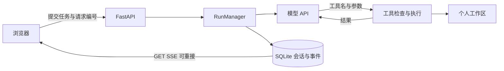

# Agent Phone

[](https://github.com/5hlw31/agent-phone/actions/workflows/tests.yml)

版本 0.3.0 · [执行流程与设计](docs/architecture.md) · [验证与复现](docs/validation.md)

一个用于处理个人工作区文件的 Agent 应用。可以连续调用文件、搜索和网页工具，查看执行过程，刷新后接回任务，也可以主动停止。前端使用原生 JavaScript，后端为 FastAPI，数据保存在 SQLite。

这是 AI 辅助开发的个人项目，持续完善文件处理、任务执行与结果核对。

## 当前可以做什么

- 对话列表、标题检索、草稿保留和 Markdown 导出。
- 流式回复与可展开的工具记录，区分执行中、完成、失败和未确认。
- 选择或拖拽上传 PDF、DOCX、文本和代码；多文件队列、进度、取消及逐项失败提示。同名文件自动另存。
- PDF / Word 保留原文件，提取正文供助手读取；支持中文文本编码转换、文档阅读视图和加入对话。
- 预览、编辑、下载文本文件；保存前核对文件版本。草稿和文件引用在当前浏览器标签页刷新后保留。
- 文件分段读取、原子写入、精确替换、文本搜索和递归查找。
- 网页提取与搜索；Git 状态、差异和提交历史只读查看。
- 刷新后接回运行中的任务；同一请求编号不会重复启动，同一会话不能同时执行两项任务。
- 任务取消、超时和调用次数限制。服务重启后把未结束的任务标为中断，保留已记录的内容，不自动重跑。
- 每次任务的文件改动记录：前后文本差异、文件内容校验、后续变更或删除提示，以及可下载的 JSON 执行报告。

代码运行、自动提交、PDF 和演示文稿生成暂不提供给模型选择。这些旧入口的执行环境或输出还没有完成验收；下一轮分别完善后再开放。

### 文件上传

每个文件最多 10 MB，一次最多 10 个。上传后自动加入当前对话草稿，发送任务后模型才会读取所引用的文件。上传时切换对话，引用会保留在原对话草稿，避免串入别的任务。

PDF 和 DOCX 原文件原样保存，可下载；旁边的 `.text.md` 是提取正文，模型也可以通过原文件名读取它。提取只包含文字，图片、公式和复杂表格需核对原文件；扫描件没有文字时明确提示，不声称完成 OCR。单份文档最多提取 200 页 PDF 或 20 万字符，达到限制会标注。

文档在独立子进程中解析，15 秒超时，限制输出；Linux 另设内存和 CPU 上限。DOCX 不解压到磁盘，检查展开大小和 XML 定义。当前支持新式 Word `.docx`，旧 `.doc`、图片与压缩包需先转换或解压。文本文件按 UTF-8、带 BOM 的 UTF-16 或 GB18030 解码，统一以 UTF-8 保存。

### 文件改动与执行报告

任务结束后，页面列出通过文件工具记录到的内容变化。可以打开结果文件、查看每次写入的差异、重新核对当前内容，或下载执行报告。报告分别保存任务结束状态、工具成功/失败/未确认数量和文件状态；模型最后的回答不用于推断文件是否改变。

写入前先在 SQLite 保存 pending 记录，写入后读取实际文件并保存前后 SHA-256、大小和有界文本差异。取消和异常也会检查已发生的修改；突然退出而来不及记录结果的操作保留为未确认。文件和数据库不是一个原子事务，pending 状态用于明确这个间隙，不能保证任意崩溃都恢复成完整记录。

重新打开对话时重新核对当前文件。如果后来编辑、删除或变成不可读取路径，页面会标出，历史差异继续保留。功能从本版新任务开始启用，旧任务会说明没有启用记录。它目前仅覆盖 `write_file` 和 `edit_file`，不追踪用户手动上传、编辑、外部程序或网页操作，也不提供回滚；记录可以证明某次文件内容变化，不能证明输出的语义正确。

差异只在 UTF-8、256 KB / 3000 行以内生成，并限制保存长度；较大文件保留校验值和大小。报告包括工作区文件差异，沿用原有登录保护；程序不会额外收集服务端配置或模型内部推理。

## 本地启动

服务端使用 Python 3.11 及以上，面向 Linux 或 macOS。Windows 可在 WSL 中运行。

```bash
python3 -m venv .venv
.venv/bin/python -m pip install -r requirements.txt
cp .env.example .env
# 在本机编辑 .env 后启动
.venv/bin/python -m uvicorn main:create_app --factory --host 127.0.0.1 --port 8000
```

打开 `http://127.0.0.1:8000/`。模型密钥只由服务端读取。已有实例升级时保留自己的口令、令牌、工作区和数据库。0.3 使用应用工厂启动，旧的 main:app 启动方式需要同步调整。

`requirements-tested.txt` 记录本机 Python 3.12 的依赖；`requirements-linux311.txt` 对应服务器 Python 3.11。验证范围见 [验证与复现](docs/validation.md)。

### 不调用模型的演示

```bash
.venv/bin/python -m uvicorn demo_server:app --app-dir tests --host 127.0.0.1 --port 8796
```

页面会标注“本地演示 · 模拟模型”。它使用临时目录和固定的模型回复，文件读写与 HTTP 接口仍实际执行。可用来检查操作流程，不能据此评价真实模型的任务完成质量。

## 配置

| 变量 | 用途 |
|---|---|
| `DEEPSEEK_API_KEY` | 模型服务的访问凭证 |
| `DEEPSEEK_BASE_URL` | 兼容 API 地址，默认 `https://api.deepseek.com` |
| `DEEPSEEK_MODEL` | 模型标识，当前默认 `deepseek-flash` |
| `LOGIN_PASSWORD` | 工作区登录口令 |
| `AUTH_TOKEN` | 浏览器访问 API 的令牌；配置后重启仍可沿用 |
| `AGENT_WORKSPACE` | 可读写的文件根目录，默认项目下 `workspace/` |
| `AGENT_DATABASE` | SQLite 文件位置，默认 `data/agent.db` |
| `MAX_TOOL_ROUNDS` | 每次任务的模型调用轮次上限，默认 8 |
| `MAX_TOOL_CALLS` | 每次任务的工具调用次数上限，默认 16 |
| `AGENT_RUN_TIMEOUT` | 每次任务总时限，默认 180 秒 |
| `AGENT_THINKING` | DeepSeek 思考模式，默认 `disabled` |

服务使用一个进程，启动时会锁定数据库，防止多个实例各自恢复或取消同一任务。旧的 `SYSTEM_PROMPT` 不再控制本版默认提示，提示内容统一在 `config.py` 中维护。

## 代码结构

| 文件 | 职责 |
|---|---|
| `main.py` | 应用工厂、登录、任务和文件接口 |
| `agent_runtime.py` | 异步模型循环、工具结果回传、上下文和任务管理 |
| `store.py` | 会话、任务状态、事件及重启恢复 |
| `workspace.py` | 共用的文件规则、受限打开与原子保存 |
| `tools.py` | 工具定义、参数检查、文件与 Git 操作 |
| `network.py` | 公网地址检查、连接地址固定及重定向检查 |
| `uploads.py`、`extract_document.py` | 上传格式、编码、同名另存与文档解析子进程 |
| `change_journal.py` | 任务写入记录、前后差异及当前文件核对 |
| `static/` | 页面、样式、交互和本地 Markdown 依赖 |



浏览器断线只中断接收；“停止”通过取消接口通知后台任务。已完成的文件写入不会撤销。Git 子进程会在超时或取消时清理；搜索库的只读线程可能等待它自身的网络超时结束，但结果不会继续触发下一项工具。

原始聊天单独保留，模型请求按完整用户轮次选择近期上下文，避免把工具调用与结果拆开。当前使用消息数和字符预算，并非精确 token 计量。

## 验证与范围

```bash
.venv/bin/python -m unittest discover -s tests -v
```

本地检查覆盖真实临时文件与 Git 仓库、参数和路径、异步循环、取消、重启、请求去重、API 登录和文件版本、DNS 与重定向等。模型部分使用测试流；真实模型检查另记在 [验证说明](docs/validation.md)中。

文件工具只访问工作区，拒绝符号链接、受保护路径和特殊文件。命令工具是有限的文件查看适配器，不提供主机 shell。Git 工具清理子进程环境，拒绝外部过滤器等额外执行配置。这些属于应用层限制，不能称为完整操作系统沙箱，也不能证明已抵御所有提示注入。

参考：[DeepSeek 接口](https://api-docs.deepseek.com/api/create-chat-completion/)、[FastAPI 生命周期](https://fastapi.tiangolo.com/advanced/events/)、[Git 配置](https://git-scm.com/docs/git-config)、[pypdf 文字提取](https://pypdf.readthedocs.io/en/stable/user/extract-text.html)、[Python ZIP 文档](https://docs.python.org/3/library/zipfile.html)。本地 Markdown 依赖的版本及许可证放在 `static/vendor/`。
